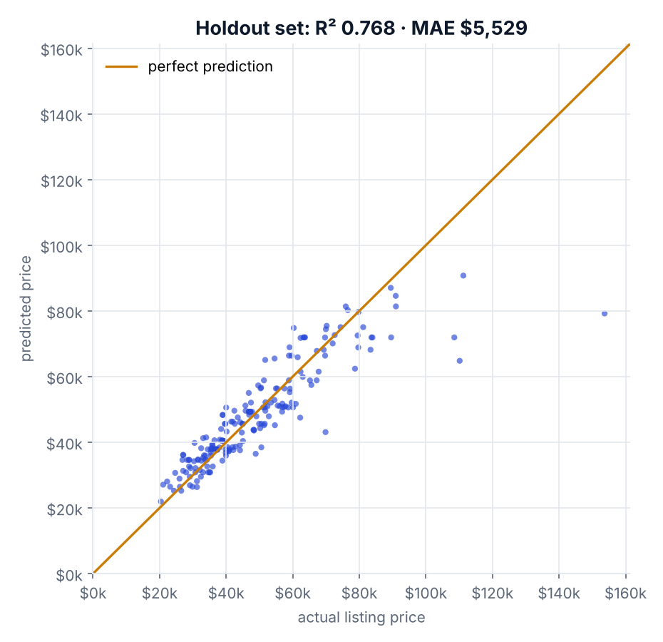
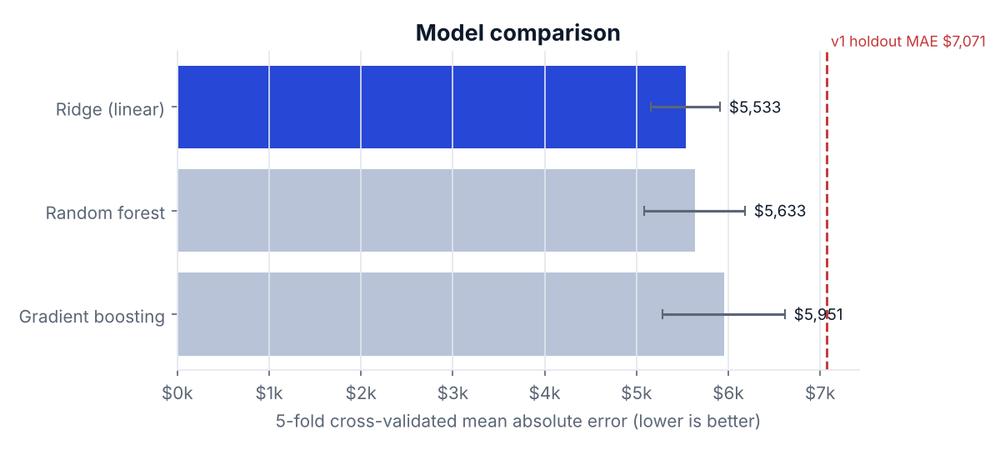
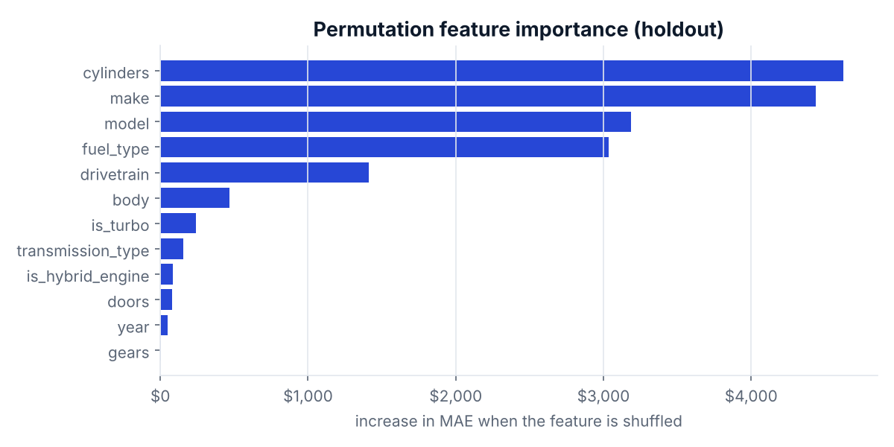
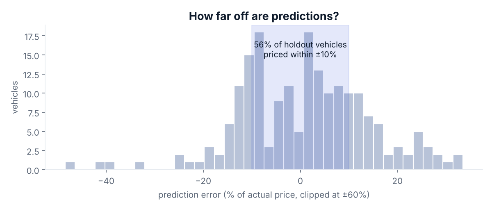

# Vehicle Price Prediction

[](https://github.com/vishavjit-singh/vehicle-price-prediction/actions/workflows/ci.yml)


Predicts the listing price of a new or near-new vehicle from its make, model, year, powertrain and body. The whole workflow (cleaning, feature engineering, encoding, scaling and the regressor) is a **single scikit-learn pipeline saved as one file**, so whatever you train is exactly what you serve.



## Results

The data is a 2023–2025 US listings dataset: 1,002 rows, 978 usable after removing missing and placeholder prices. It was split 80/20 with a fixed seed.

| | v1 (original script) | v2 (this version) |
|---|---|---|
| Holdout MAE | $7,071 | **$5,529** |
| Holdout R² | 0.326 | **0.768** |
| Holdout MAPE | 14.2% | **10.7%** |
| Unseen make/model at prediction time | crashes (`LabelEncoder`) | handled |
| Artifacts to ship | 8 `.pkl` files | 1 `.joblib` pipeline |

The v1 numbers come from re-running the original approach on the same split (`baseline_v1` in [`reports/metrics.json`](reports/metrics.json)). All figures are produced by `make all`.

<table>
<tr>
<td></td>
<td></td>
</tr>
</table>



**What the charts show**

- Three models are compared with 5-fold cross-validation, and the winner is chosen automatically by CV error. Regularised linear regression on a log-price target won here. With under 1,000 rows, well-encoded features beat a more complex model.
- Cylinder count, make, model and fuel type drive price the most. Year matters little because almost every listing is a 2024 model.
- About half of holdout vehicles are priced within ±10%. The largest misses are rare luxury trims, which have too few examples to learn from.

## What changed in v2

| Problem in v1 | Fix |
|---|---|
| `LabelEncoder` imposes a fake order on categories and fails on any new make or model | One-hot encoding with rare-category pooling and `handle_unknown` |
| Preprocessing and model saved separately (8 files) and reassembled by hand | One `Pipeline` + `TransformedTargetRegressor` artifact |
| Skewed price target fitted directly | Model trained on `log1p(price)` and inverted on output |
| 38 messy transmission strings encoded as-is | Parsed into gear count + type (automatic / CVT / dual-clutch / manual) |
| Free-text engine field ignored | Turbo and hybrid flags extracted |
| A $0 placeholder price used as training data | Prices under $1,000 treated as data errors |
| Single train/test score, one model | 5-fold CV model selection, holdout metrics, saved report |
| Notebook-only workflow | CLI, tests, CI, Docker |

## Quickstart

```bash
git clone https://github.com/vishavjit-singh/vehicle-price-prediction.git
cd vehicle-price-prediction
pip install -r requirements-dev.txt

make all        # train (CV + holdout) and render the charts
make test       # 8 tests
```

Price a vehicle with the bundled model:

```bash
PYTHONPATH=src python -m vehicle_price predict \
  --make Jeep --model Wagoneer --year 2024 --cylinders 6 \
  --fuel Gasoline --body SUV --drivetrain "Four-wheel Drive"
# Estimated price: $68,979
```

Use it from Python:

```python
from vehicle_price.predict import predict
predict([{"make": "Hyundai", "model": "Tucson", "year": 2024, "fuel": "Hybrid", "body": "SUV"}],
        "models/vehicle_price_pipeline.joblib")
```

Docker:

```bash
docker build -t vehicle-price .
docker run --rm vehicle-price predict --make Ford --model F-150 --year 2024 --body "Pickup Truck"
```

## Project structure

```
├── data/vehicles.csv                 # source dataset
├── models/vehicle_price_pipeline.joblib
├── notebooks/exploration.ipynb       # original exploratory notebook (v1)
├── reports/
│   ├── metrics.json                  # CV scores, holdout metrics, v1 baseline
│   └── holdout_predictions.csv
├── src/vehicle_price/
│   ├── features.py                   # cleaning + feature engineering
│   ├── model.py                      # candidate pipelines
│   ├── train.py                      # CV selection, holdout eval, v1 baseline
│   ├── predict.py
│   ├── report.py                     # README charts
│   └── cli.py
├── tests/
└── .github/workflows/ci.yml          # lint, tests, retrain, upload report
```

## Limitations

- The dataset is small (978 priced rows) and mostly 2024 models, so the model reflects new-vehicle listing prices, not used-car depreciation.
- Prices are asking prices from listings, not transaction prices.
- Rare high-end trims are under-predicted. More data per trim, or a trim-level feature, would help.

## Author

**Vishavjit Singh Saini**, Data Engineer · [GitHub](https://github.com/vishavjit-singh) · [LinkedIn](https://www.linkedin.com/in/vishavjit-singh-7011211ab/)

## License

[MIT](LICENSE)
